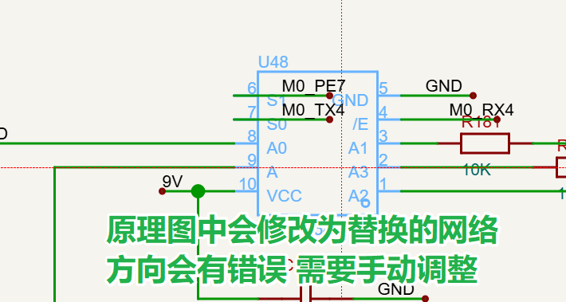

# 引脚改网向导（Pin Net Wizard）

嘉立创EDA专业版扩展 · 在 PCB 中选中引脚，按 <kbd>F8</kbd> 拾取目标网络，一键改写原理图网络名，写完自动切回 PCB。

!注意：这是一个纯AI编码项目，作者不对使用该插件照成的任何损失负责。


<!-- 图片占位：images/readme/01-overview.png（建议 900×1100，展示完整面板） -->

---


## 一、解决什么问题


先在PCB中布局时，将单片机线拉到元器件位置，直接更新原理图中的网络。

一般画板都是先画原理图，在布局PCB。在原理图中一般是使用网络名称进行元器件连接。

单片机很多引脚可以映射，会在拉线时根据布局进行引脚选择。


1. 在原理图里找到该器件的该引脚；
2. 更新为布局时实际使用的引脚；
5. 回到 PCB 。

引脚多的时候，这套操作要重复几十遍，

本扩展把全过程压缩成：**PCB 选引脚 → F8 → PCB 选目标网络 → F8 → 点一次写入**，并且支持一次排好多个引脚，最后统一写入。

---

## 二、功能特性

| 特性 | 说明 |
| --- | --- |
| **两阶段拾取** | 一个按钮两种用途：第一次点读「原始网络」，第二次点读「替换网络」，按钮状态由面板自动判断 |
| **<kbd>F8</kbd> 快捷键** | PCB 画布内直接按 F8 完成拾取，无需在面板和画布之间来回点 |
| **多组批量写入** | 默认开启。连续拾取多组「引脚 → 替换网络」后，一次性写入并统一保存 |
| **智能断网** | 删除引脚上的原有导线；被连带的邻居引脚会自动按**原网络名**补回引出线，不会把别人的网络弄丢 |
| **写完自动回 PCB** | 不再产生「多个原理图页 + 1 个 PCB 页」混在一起找 tab 的困扰 |
| **不留高亮残留** | 拾取过程只读，不修改选中集、不高亮网络；写入结束自动清空 PCB 选中 |
| **只保存一次** | 批量写入 N 组只触发 1 次原理图保存，不是每组存一次 |

---

## 三、安装

**方式 A：扩展广场安装**

在嘉立创EDA专业版中搜索扩展名「引脚改网向导」并安装。


安装后，PCB 和原理图编辑器的顶部菜单都会出现「PCB焊盘改网络」菜单项，点击「打开向导」即可唤出面板。


<!-- 图片占位：images/readme/02-menu.png（截取 PCB 顶部菜单中的「引脚改网」项） -->

---

## 四、快速上手

### 第 1 步 · 选择原始网络

在 **PCB** 中选中要修改的引脚（单个焊盘，或整个器件后从面板列表里挑具体引脚），然后：

- 按 <kbd>F8</kbd>，或
- 点面板上的「拾取选中图元的网络」按钮

面板顶部会出现橙色提示条：**选择替换网络**。


<!-- 图片占位：images/readme/03-step1.png（PCB 中选中一个焊盘 + 面板显示第 1 步提示） -->

### 第 2 步 · 选择替换网络

在 **PCB** 中选中目标网络的任意一个图元——焊盘、导线、过孔都行——再按一次 <kbd>F8</kbd>。

面板会把这一组「引脚：原网络 → 新网络」加入待写入队列，并自动清空当前选择，直接进入下一轮。


<!-- 图片占位：images/readme/04-step2.png（选中一根导线拾取网络 + 面板显示新网络名） -->

### 第 3 步 · 一次性写入

重复第 1、2 步，把所有要改的引脚都加入队列，然后点「**一次性写入（N 组）**」。

扩展会依次：断开每组引脚的原网络 → 重建引出导线并写入新网络名 → 全部完成后统一保存原理图 → 切回 PCB 并清空选中。

### 第 4 步 · 原理图更新状态


### 第 5 步 · 手动同步原理图中的网络修改


###  高亮选中取消

有BUG 有时会高亮选中的网络
在PCB空白地方点击鼠标右键 菜单中 取消全部高亮就行


<!-- 图片占位：images/readme/05-queue.png（面板中多条待写入任务的队列） -->

写入结果会逐条打印在面板日志里：

```
[12:55:02] ✓ Q18.2 → M0_SDA3：删 1 段导线，回读网络 M0_SDA3
[12:55:02] ✓ Q38.2 → M0_PA9：删 1 段导线，回读网络 M0_PA9
[12:55:03] 原理图已统一保存。
[12:55:03] 已切回 PCB 页面。
```


<!-- 图片占位：images/readme/06-result.png（日志区显示全部成功 + 已切回 PCB） -->

---

## 五、面板说明

| 区域 | 作用 |
| --- | --- |
| 顶部提示条 | 大字显示当前该做什么：①选原始网络 / ②选替换网络 / ✓完成 |
| 拾取按钮 | 两阶段通用按钮，行为随当前阶段自动切换 |
| 重选引脚 | 放弃当前引脚，回到第 1 步重新选 |
| 多组模式 | 默认勾选。取消后每次只保留最后一组任务 |
| 当前引脚行 | 显示 `位号.引脚号` 与原网络，方便核对 |
| 待写入队列 | 每条任务可单独删除，显示「引脚：原网络 → 新网络」 |
| 网络下拉 / 手输 | 兜底手段：不想在 PCB 点选时，可直接从列表选或手输网络名 |
| 日志区 | 每步操作与写入结果的完整记录 |

---

## 六、写入原理图时具体做了什么

对每一组任务：

1. **定位引脚**：根据当前 PCB 找到关联的原理图板子，逐页查找该位号器件，取出目标引脚的坐标；
2. **断开原网络**：找出所有端点落在该引脚上的导线并删除；
3. **保住邻居**：扫描被删导线的另一端，若那里接着别的引脚且已无其他导线连接，则按**原网络名**补一段引出短线，避免邻居断网；
4. **写入新网络**：从目标引脚引出一段独立的水平短线，并赋予替换网络名（等价于在引脚上放一个网络标签）；
5. **回读校验**：重新读取这段导线的网络名，与目标不一致时自动 `modify` 补写一次，仍不一致会在日志里标黄提醒；
6. **收尾**：全部组处理完保存原理图一次 → 切回 PCB → 清空 PCB 选中集。

---

## 七、快捷键

| 快捷键 | 作用域 | 功能 |
| --- | --- | --- |
| <kbd>F8</kbd> | PCB 画布（选中/未选中均可） | 「拾取选中图元的网络」，等价于点面板按钮 |

- 面板右上角显示 `F8 拾取网络` 表示注册成功；若显示 `F8 注册失败，请用按钮`，说明 F8 被其它功能占用，请直接点按钮。
- 按 F8 时若面板未打开，会自动打开面板并继续执行拾取。

---

## 八、注意事项与限制

> **写操作属于批量修改，执行前请先备份工程**（文件 → 备份 / 另存为）。

1. **接口状态**：`pcb_PrimitivePad`、`sch_PrimitiveWire`、`*_SelectControl` 等接口在官方文档中标记为 **BETA**，不同 EDA 版本的行为可能有差异，建议先在测试工程验证。
2. **PCB 与原理图必须关联**：扩展通过「板子」找到 PCB 对应的原理图，若工程中两者未建立关联，会提示「未找到与当前 PCB 关联的原理图」。
3. **引脚号必须对应**：定位原理图引脚依赖 PCB 焊盘号与原理图引脚号完全一致（如 PCB 的 `2` 对应原理图的 `2`）。
4. **原理图需存在于同一工程**：扩展不会跨工程查找器件。
5. **同名网络不会产生变化**：替换网络与原网络相同时，面板会给出警告，但不会阻止执行。
6. **自动保存**：写入完成后会自动保存原理图。如需先检查再保存，请先备份工程。

---

## 九、常见问题

**Q：按 F8 没反应？**
先确认焦点在 PCB 画布内（点一下画布空白处），再看面板右上角是否显示「F8 注册失败」。

**Q：提示「请在 PCB 编辑器中使用本向导」？**
当前焦点文档不是 PCB。请切到 PCB 标签页，并在面板上点一下按钮（面板获得焦点后，宿主仍会以最后聚焦的文档为准）。

**Q：提示「新建引出导线失败：该位置可能已被占用」？**
引脚两侧被其它图元占满时会失败。扩展会自动换方向、换长度重试三轮；仍失败请手动清理该引脚附近的图元后重试。

**Q：一个引脚能一次改到多个网络吗？**
不能。一个引脚只保留一个网络；重复拾取同一引脚会覆盖队列中该引脚的旧任务。

**Q：能改悬空（无网络）的引脚吗？**
可以。原网络为空时，扩展只执行「建线 + 写网络名」这一步。

---

## 十、更新日志

见 [CHANGELOG.md](./CHANGELOG.md)。

---

## 十一、开源许可

本扩展基于 [Apache License 2.0](./LICENSE) 发布。

依据该协议，你仅可以将 **嘉立创EDA**、**EasyEDA** 商标信息用于依托于本扩展开发的扩展包的 **功能描述部分** 和 **开源发布的标题部分**。
