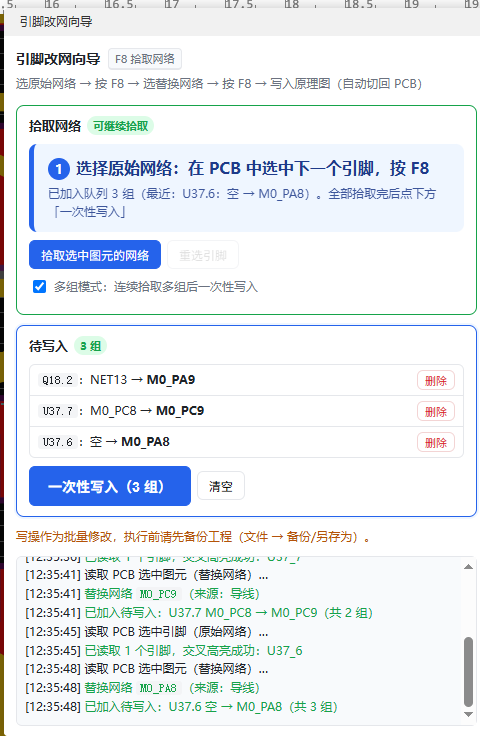
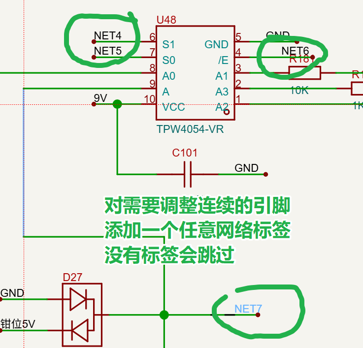
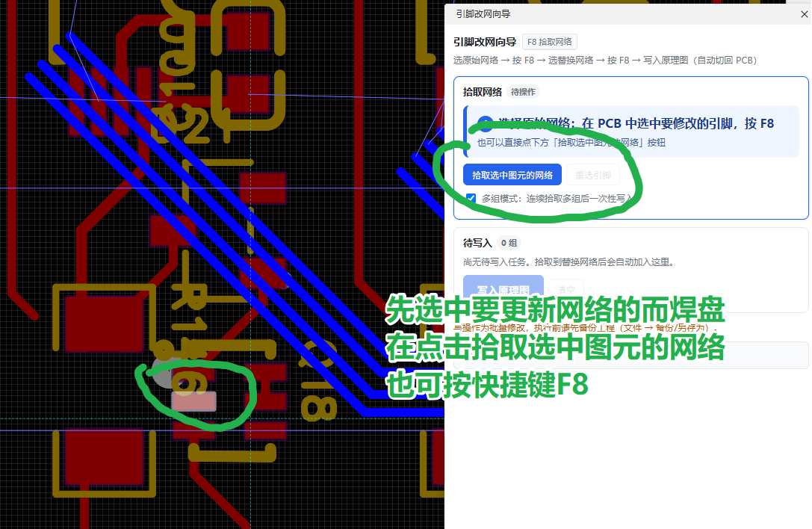
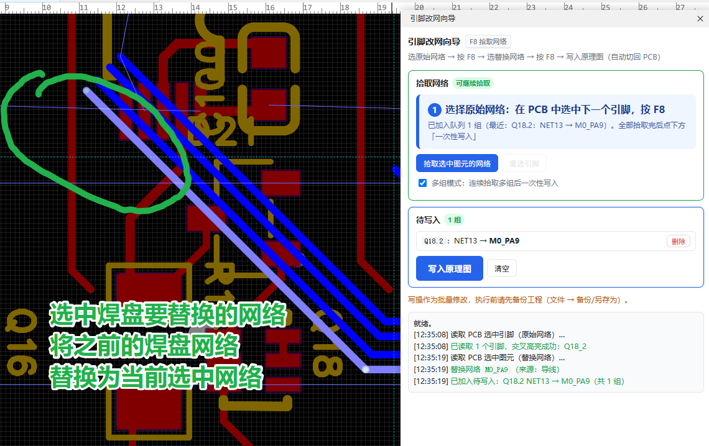
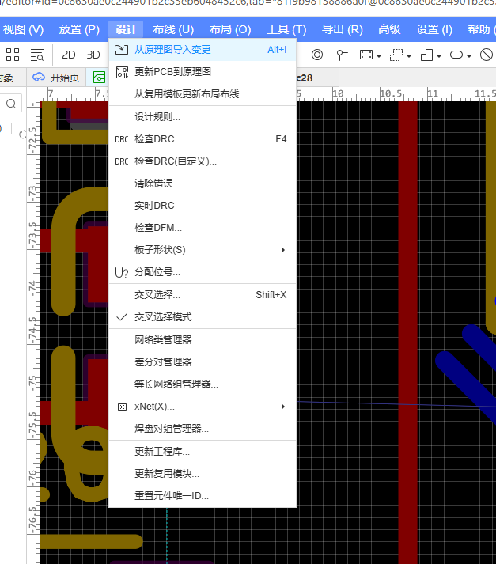
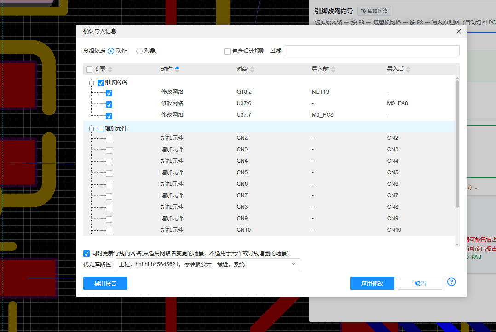
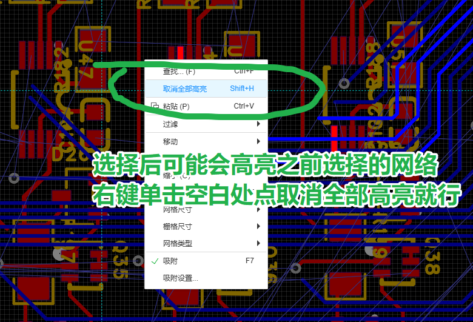

# PCB焊盘改网络（Pin Net Wizard）

嘉立创EDA专业版扩展 · 在 PCB 中选中引脚，按 <kbd>F8</kbd> 拾取目标网络，一键改写原理图中**已经命名的网络标签**，写完自动切回 PCB。

!注意：这是一个纯AI编码项目，作者不对使用该插件照成的任何损失负责。




---


## 一、解决什么问题

## 注意！ 网络标签需要唯一不重复，否则会将整个网络标签改名

一般画板都是先画原理图，在布局PCB。在原理图中一般是使用网络名称标识，布局时在连接。

单片机很多引脚可以映射，会在拉线时根据布局进行引脚选择。

之前流程
1. 在原理图里找到该器件的该引脚；
2. 添加（更新）标签为PCB布局时实际使用的引脚；
3. 回到 PCB 。

引脚多的时候，这套操作要重复几十遍，

本扩展把全过程压缩成：**PCB 选引脚 → F8 → PCB 选目标网络 → F8 → 点一次写入**，并且支持一次排好多个引脚，最后统一写入。

> **使用前提**：扩展只做一件事——把原理图中**已经命名的网络标签**改名。
> 动手前请先在原理图里给要改的元器件引脚（或其所在网络）放好网络标签，也就是说该引脚对应的网络**必须已经有一个名字，名称唯一不重复**。
> 没有网络标签的网络会被跳过，扩展不会替你新建标签，也不会改动任何导线。

作者只对单页原理图进行验证。


---

## 三、安装

**方式 A：扩展广场安装**

在嘉立创EDA专业版中搜索扩展名「引脚改网向导」并安装。


安装后，PCB 和原理图编辑器的顶部菜单都会出现「PCB焊盘改网络」菜单项，点击「打开向导」即可唤出面板。


---

## 四、快速上手

### 第 0 步 · 先给原理图元器件引脚添加标签（网络标签唯一不重复）

## 注意！ 网络标签需要唯一不重复，否则会将整个网络标签改名

扩展不创建、不修改导线，只把**已有的网络标签**改名。所以在 PCB 里动手之前：

1. 打开原理图，找到准备改的元器件引脚；
2. 在该引脚（或其所在导线）上放置**网络标签**，写上当前网络名（例如 `NET2` 不与其它标签重复）；

> 没有网络标签的网络，写入时会被跳过（日志会写明原因），不会被改动。



### 第 1 步 · 选择原始网络

在 **PCB** 中选中要修改的元器件引脚（单个焊盘，或整个器件后从面板列表里挑具体引脚），然后：

- 按 <kbd>F8</kbd>，或
- 点面板上的「拾取选中图元的网络」按钮

面板顶部会出现橙色提示条：**选择替换网络**。




### 第 2 步 · 选择替换网络

在 **PCB** 中选中目标网络的任意一个图元——焊盘、导线、过孔都行——再按一次 <kbd>F8</kbd>。

面板会把这一组「引脚：原网络 → 新网络」加入待写入队列，并自动清空当前选择，直接进入下一轮。




### 第 3 步 · 一次性写入

重复第 1、2 步，把所有要改的引脚都加入队列，然后点「**一次性写入（N 组）**」。

扩展会依次：为每组引脚找到同名的网络标签并改掉标签文字（导线一根不动）→ 全部完成后统一保存原理图 → 切回 PCB 并清空选中。

- 找不到同名标签的组会被**跳过**，不做任何修改；全部组都跳过时不写盘；
- 同一原网络被多组引用时，第二组会自动跳过并提示「已随上一组改名」。


### 第 5 步 · 手动同步原理图中的网络修改





###  高亮选中取消

有BUG 有时会高亮选中的网络
在PCB空白地方点击鼠标右键 菜单中 取消全部高亮就行




写入结果会逐条打印在面板日志里：

```
[12:55:02] ✓ U36.7 → M0_RX3：网络标签改名 NET2 → M0_RX3
[12:55:02] ✓ U36.4 → M0_PH3：网络标签改名 NET3 → M0_PH3
[12:55:03] − U40.1 → GND：跳过（原理图中没有名为 NET9 的网络标签，已跳过（本页属性 37 个：…））
[12:55:03] 原理图已统一保存。
[12:55:03] 已切回 PCB 页面。
```


---

## 六、写入原理图时具体做了什么

对每一组任务：

1. **定位引脚**：根据当前 PCB 找到关联的原理图板子，逐页查找该位号器件，定位到目标引脚所在的图页；
2. **确定原网络名**：优先用 PCB 侧读到的焊盘网络名（PCB 网络名与原理图未改动前完全一致），读不到时再从该引脚上的导线读取；
3. **找网络标签**：取当前图页的属性图元，凡是 `名称` 或 `值` 等于原网络名的，就是这条网络的网络标签（同名标签可能不止一个）；
4. **只改标签文字**：对每个命中的标签执行 `modify({ value: 新网络名 })`；如果该版本把网络名放在 `key` 上，则 `key` 一起改。**全程不创建、不删除、不拆分、不改写任何导线**；
5. **没有标签就跳过**：一个标签都没命中时，该组直接跳过，返回原因并附带本页属性摘要（例如 `本页属性 37 个：Net=NET2；…`），方便排查；
6. **回读校验**：重新读取标签文字，与目标不一致会在日志里标黄提醒；
7. **收尾**：全部组处理完，有改动才保存原理图一次 → 切回 PCB → 清空 PCB 选中集。

批量语义补充：

- 同一原网络被多组任务引用时，第二组会自动跳过并提示「已随上一组改名」，不会链式改名；
- 全部组都跳过时不写盘，日志会说明「本次没有任何改动」；
- 扩展不做 DRC 处理，改完的网络是否正确请自行在 EDA 中验证。

---

## 七、快捷键

| 快捷键 | 作用域 | 功能 |
| --- | --- | --- |
| <kbd>F8</kbd> | PCB 画布（选中/未选中均可） | 「拾取选中图元的网络」，等价于点面板按钮 |

- 面板右上角显示 `F8 拾取网络` 表示注册成功；若显示 `F8 注册失败，请用按钮`，说明 F8 被其它功能占用，请直接点按钮。
- 按 F8 时若面板未打开，会自动打开面板并继续执行拾取。

---

## 八、注意事项与限制

> **写操作属于批量修改，执行前请先备份工程**（文件 → 备份 / 另存为）。

1. **必须先有网络标签（最重要）**：扩展只给**已命名的网络标签**改名。使用前请在原理图里给要改的引脚/网络放置网络标签，并保证标签名与 PCB 侧网络名一致；没有标签的网络会被跳过。
2. **导线一律不动**：不新建、不删除、不拆分、不改写导线，也不设置导线自身的网络名。若需要"从无到有"地给引脚挂网络名，请在原理图里手动放置标签。
3. **只处理当前图页**：标签查找范围是引脚所在的那一页；跨页网络的标签若不在该页，不会被改名。
4. **接口状态**：`sch_PrimitiveAttribute`、`pcb_PrimitivePad`、`sch_PrimitiveWire`、`*_SelectControl` 等接口在官方文档中标记为 **BETA**，不同 EDA 版本行为可能有差异；网络标签接口自 **EDA v4** 起提供，客户端版本过低时可能取不到标签。
5. **PCB 与原理图必须关联**：扩展通过「板子」找到 PCB 对应的原理图，若工程中两者未建立关联，会提示「未找到与当前 PCB 关联的原理图」。
6. **引脚号必须对应**：定位原理图引脚依赖 PCB 焊盘号与原理图引脚号完全一致（如 PCB 的 `2` 对应原理图的 `2`）。
7. **原理图需存在于同一工程**：扩展不会跨工程查找器件。
8. **同名网络不会产生变化**：替换网络与原网络相同时，面板会给出警告，但不会阻止执行。
9. **不做 DRC 处理**：改名后是否产生短路、网络冲突等，请自行在 EDA 中检查（更新 PCB 时 EDA 也会给出提示）。
10. **自动保存**：有改动时才会保存原理图；全部跳过不写盘。如需先检查再保存，请先备份工程。

---

## 九、常见问题

**Q：按 F8 没反应？**
先确认焦点在 PCB 画布内（点一下画布空白处），再看面板右上角是否显示「F8 注册失败」。

**Q：提示「请在 PCB 编辑器中使用本向导」？**
当前焦点文档不是 PCB。请切到 PCB 标签页，并在面板上点一下按钮（面板获得焦点后，宿主仍会以最后聚焦的文档为准）。

**Q：提示「原理图中没有名为 NET2 的网络标签，已跳过」？**
说明原理图里没有叫 `NET2` 的网络标签。三种常见原因：

- 该网络在原理图中没有放网络标签 —— 手动放一个同名标签即可；
- 标签名字与 PCB 网络名不一致（大小写、空格、前缀不同）—— 改成完全一致；
- 标签不在引脚所在的那一页 —— 扩展只扫当前图页。

日志括号里会附带本页属性摘要（`本页属性 N 个：Net=…`），可据此判断标签到底存不存在。

**Q：能改悬空（没有网络名）的引脚吗？**
不能。扩展只改"已经命名的网络标签"，不会新建标签、不会改导线。请先在原理图里给该引脚放一个网络标签。

**Q：一个引脚能一次改到多个网络吗？**
不能。一个引脚只保留一个网络；重复拾取同一引脚会覆盖队列中该引脚的旧任务。

**Q：改名后原理图里的导线会变吗？**
不会。扩展只修改网络标签的文字，导线、端点、连接关系一律不动。

**Q：会不会自动处理 DRC/网络冲突？**
不会。扩展不做任何 DRC 判断，改名后请自行在 EDA 中验证。

---

## 十、更新日志

见 [CHANGELOG.md](./CHANGELOG.md)。

---

## 十一、源码

| 用途 | 地址 |
| --- | --- |
| 项目源码 | <https://github.com/wjzhx/pin-net-wizard> |


---

## 十二、开源许可

本扩展基于 [Apache License 2.0](./LICENSE) 发布。

依据该协议，你仅可以将 **嘉立创EDA**、**EasyEDA** 商标信息用于依托于本扩展开发的扩展包的 **功能描述部分** 和 **开源发布的标题部分**。
